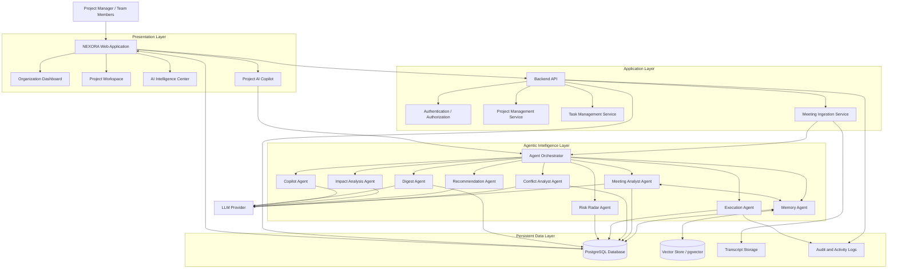
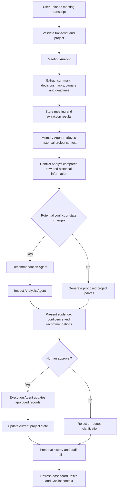
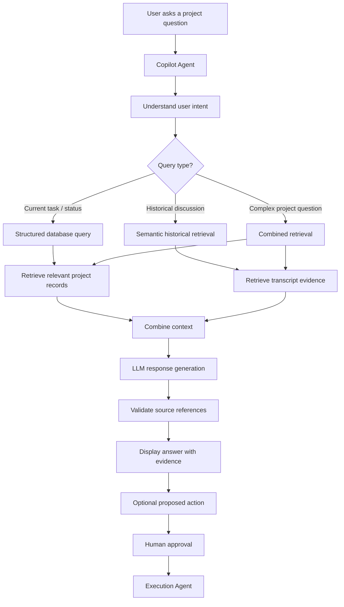

# NEXORA
## Product Requirements Document (PRD)
### Agentic Project Intelligence & Execution Platform

**Version:** 1.0  
**Product Name:** NEXORA  
**Product Category:** Agentic AI / Project Intelligence / Enterprise Productivity  
**Document Status:** Approved for Development  
**Primary Release:** Hackathon MVP  
**Target Development Time:** 6–7 Hours  
**Primary Users:** Project Managers, Scrum Masters, Developers, Team Leads and Project Members

---

# 1. Executive Summary

## 1.1 Product Overview

NEXORA is an AI-powered Project Intelligence and Execution Platform that transforms unstructured meeting conversations into structured, continuously updated project intelligence.

Modern teams conduct Scrum meetings, sprint planning sessions, technical reviews and project discussions every day. These meetings generate important information about project decisions, technical choices, responsibilities, deadlines, blockers and dependencies.

However, much of this information remains scattered across meeting transcripts, chat messages, documents and individual memory.

NEXORA solves this problem by introducing an intelligent layer between team conversations and project execution.

After every meeting, users upload a meeting transcript. NEXORA's coordinated AI agents analyze the discussion, extract important information, retrieve historical project context, identify changes and contradictions, evaluate potential impacts, generate recommendations and propose updates to the project.

Users can review and approve these changes before they become part of the official project state.

The platform also maintains persistent project memory, provides a conversational AI copilot, monitors deadlines and project risks, and generates personalized work summaries.

NEXORA is designed to evolve from a meeting-to-execution assistant into an intelligent operating layer for project teams.

## 1.2 Product Tagline

**Your projects. One intelligence.**

Alternative positioning statement:

**From meeting conversations to intelligent project execution.**

## 1.3 Core Value Proposition

NEXORA does not simply summarize meetings.

It understands how a project evolves over time.

It remembers:
- What decisions were made.
- Why those decisions were made.
- Who is responsible for each activity.
- Which deadlines were committed.
- What changed in subsequent meetings.
- Which previous decisions may have become invalid.
- Which tasks and project components may be affected.
- What requires human attention.

It then turns this understanding into actionable project intelligence.

## 1.4 Core Product Differentiators

1. **Persistent Project Memory:** Maintains historical and current project context across multiple meetings.
2. **Cross-Meeting Conflict Detection:** Identifies changes and contradictions between new discussions and historical decisions.
3. **Decision Intelligence:** Provides evidence-backed recommendations and resolution options.
4. **Impact Analysis:** Identifies tasks, people, deadlines and components potentially affected by a project change.
5. **Agentic Execution:** Converts approved meeting outcomes into structured project updates and tasks.
6. **Project AI Copilot:** Answers questions using structured project data and historical meeting context.
7. **Proactive Risk Intelligence:** Identifies potential delays, blockers, unresolved decisions and workload issues.

---

# 2. Problem Statement

## 2.1 The Problem

Project teams depend heavily on recurring meetings to coordinate their work.

During Scrum meetings, sprint planning, technical discussions and project reviews, team members communicate important information such as:

- New technical decisions.
- Changes to previously agreed approaches.
- Task ownership changes.
- Deadline revisions.
- Progress updates.
- New dependencies.
- Project blockers.
- Resource availability.
- Risks and concerns.

Although these discussions are valuable, their outcomes are often not maintained consistently.

Meeting transcripts and notes are generally treated as isolated records rather than as continuously evolving sources of project knowledge.

Consequently, project managers and team members frequently face the following problems.

### Problem 1: Decisions Get Lost

A team may decide to use MongoDB during one meeting and discuss PostgreSQL in a subsequent meeting.

Without persistent contextual memory, it becomes difficult to determine:

- What was originally approved?
- Was the new technology merely proposed?
- Was the previous decision formally replaced?
- Which implementation tasks need modification?

Traditional meeting summarizers generally focus on the latest meeting rather than the evolution of project decisions.

### Problem 2: Responsibility Confusion

During one meeting, Arjun may be assigned database management.

During a later meeting, Sanchita may be asked to handle the same activity.

Without tracking historical ownership, the system cannot reliably determine whether:

- Arjun's responsibility was transferred.
- Sanchita is temporarily assisting.
- Both members are working together.
- The new statement was only a suggestion.

This can result in duplicated work, missed responsibilities and coordination problems.

### Problem 3: Disconnected Project Information

Project information is scattered across:

- Meeting transcripts.
- Task management systems.
- Team discussions.
- Project documents.
- Individual updates.

There is no unified intelligence layer connecting these records.

### Problem 4: Manual Project Updates

After every Scrum meeting, project managers may need to manually:

- Update task ownership.
- Modify deadlines.
- Record decisions.
- Update project status.
- Track blockers.
- Notify team members.
- Maintain project documentation.

This repetitive process consumes time and can introduce inconsistencies.

### Problem 5: Lack of Contextual Recommendations

Most project management systems record tasks and progress but do not deeply understand why a decision was made or how a new decision affects existing project work.

For example, changing a database technology could affect:

- Database schema implementation.
- Backend API integration.
- Migration scripts.
- Testing activities.
- Project deadlines.
- Team workload.

Identifying these relationships manually is difficult.

### Problem 6: Lack of Accessible Project Knowledge

Project members frequently need answers to questions such as:

- Who is responsible for API integration?
- What is the current status of Project Alpha?
- Why was the database technology selected?
- What changed in the last Scrum?
- Which decisions are awaiting approval?
- Which tasks are blocked?
- What are my priorities this week?

Answering these questions often requires reviewing multiple meetings and task records.

## 2.2 Problem Statement

**How might we build an intelligent project execution system that continuously understands project conversations, maintains organizational memory across meetings, detects changes and inconsistencies, evaluates their impact, recommends resolutions and converts approved outcomes into actionable project updates?**

NEXORA addresses this problem through a coordinated multi-agent AI architecture supported by persistent structured project memory.

---

# 3. Product Vision and Goals

## 3.1 Product Vision

To build an intelligent project workspace where project knowledge is continuously maintained, decisions remain traceable, changes are understood in context and teams can execute work with greater clarity.

## 3.2 Primary Goals

- Convert meeting transcripts into structured project information.
- Maintain persistent memory across multiple meetings.
- Automatically track project decisions and their evolution.
- Detect potential conflicts in responsibilities, technical decisions and deadlines.
- Provide evidence-backed recommendations.
- Identify the impact of proposed changes.
- Convert approved meeting outcomes into project tasks and updates.
- Provide conversational access to project information.
- Proactively identify project risks and upcoming deadlines.
- Generate personalized member work digests.

## 3.3 Success Criteria

The MVP will be considered successful when:

1. A user can create and open a project.
2. A user can add project members.
3. A user can upload or paste a meeting transcript.
4. AI can extract decisions, action items, owners, deadlines and discussion evidence.
5. Extracted information is persisted in the database.
6. A subsequent meeting can retrieve historical project context.
7. The system can detect at least one meaningful cross-meeting conflict.
8. The system can show the evidence supporting the conflict.
9. The system can recommend possible resolutions.
10. A user can approve or reject a proposed change.
11. The approved change updates the current project state.
12. The system can create and assign tasks.
13. The Project AI Copilot can answer factual project questions using stored information.
14. The deployed application works through a public URL.

---

# 4. Target Users and Personas

## 4.1 Project Manager

**Responsibilities:**
- Monitor project progress.
- Coordinate team members.
- Review meeting outcomes.
- Resolve conflicting decisions.
- Assign tasks.
- Manage deadlines.

**NEXORA value:**
A consolidated project intelligence dashboard with AI-generated insights and approval-based project updates.

## 4.2 Scrum Master / Team Lead

**Responsibilities:**
- Conduct Scrum meetings.
- Track sprint progress.
- Identify blockers.
- Maintain task ownership.
- Coordinate technical discussions.

**NEXORA value:**
Automatic meeting analysis, historical memory, change detection and task management.

## 4.3 Developer / Project Member

**Responsibilities:**
- Complete assigned tasks.
- Attend meetings.
- Report progress.
- Understand technical decisions.
- Coordinate dependencies.

**NEXORA value:**
A personal task view, searchable project history, contextual answers and personalized work digests.

---

# 5. Product Scope

NEXORA will support multiple projects within an organization.

Each project maintains its own:

- Project description.
- Members.
- Meetings.
- Decisions.
- Current technical and operational state.
- Tasks.
- Deadlines.
- Dependencies.
- Conflicts.
- Recommendations.
- Historical records.
- Project progress.

## 5.1 Main Application Navigation

The application should contain four primary navigation sections:

1. Organization Dashboard
2. Project Workspace
3. AI Intelligence Center
4. Project AI Copilot

The task management interface, meeting history, members and project configuration should be accessible through the Project Workspace.

## 5.2 MVP Input Methods

Supported inputs:

- Paste transcript text.
- Upload `.txt` transcript files.
- Upload structured text-based meeting transcripts.

The MVP will use prepared transcripts with speaker labels and optional timestamps.

Audio transcription, video processing and live meeting integrations are outside the mandatory MVP scope.

---

# 6. Functional Requirements

# 6.1 Module 1 — Organization Dashboard

## Description

The dashboard is the application's landing page.

It provides an overview of the organization's active projects, project health, pending work and AI-generated alerts.

## Requirements

### FR-001: Organization Overview

Display:
- Total active projects.
- Total meetings analyzed.
- Total active tasks.
- Pending tasks.
- Completed tasks.
- Overdue tasks.
- Unresolved AI conflicts.

All figures must be derived from actual stored data.

### FR-002: Project Listing

Display a list of projects with:

- Project name.
- Project description.
- Project manager.
- Number of members.
- Completion percentage.
- Active tasks.
- Project deadline.
- Project health status.
- Last updated timestamp.

### FR-003: Project Health

Display one of the following:

- On Track.
- Needs Attention.
- At Risk.
- Completed.

Project health should be determined using explicit rules based on available task, deadline, blocker and conflict data.

### FR-004: AI Attention Center

Display important items requiring attention:

- Unresolved decision conflicts.
- Ownership changes awaiting confirmation.
- Overdue tasks.
- Upcoming critical deadlines.
- Unresolved blockers.
- High-impact project changes.

Each item must navigate to its relevant project or intelligence record.

### FR-005: Recent Activity

Show recent events:

- Meeting analyzed.
- Decision created.
- Decision approved.
- Task created.
- Task completed.
- Deadline changed.
- Conflict detected.
- Conflict resolved.

### FR-006: Quick Actions

Provide:
- Create Project.
- Upload Meeting.
- View Tasks.
- Open AI Copilot.

---

# 6.2 Module 2 — Project Management

## Description

Users can create, view and manage multiple projects.

Each project acts as an isolated knowledge and execution workspace.

## FR-007: Create Project

Required fields:

- Project name.
- Project description.
- Project manager.
- Start date.
- Target deadline.

Optional fields:

- Project objectives.
- Technology stack.
- Requirements.
- Milestones.
- Project-specific notes.

## FR-008: Manage Members

Each project supports multiple members.

Member fields:

- Name.
- Email.
- Role.
- Responsibilities.
- Active status.

Suggested roles:

- Project Manager.
- Scrum Master.
- Developer.
- Designer.
- Tester.
- Other.

For the MVP, members can be seeded demo records without implementing full authentication or invitation functionality.

## FR-009: Project Context

Store project-level information that agents can retrieve during analysis.

Examples:

- Project objectives.
- Business requirements.
- Technical requirements.
- Approved technology stack.
- Important constraints.
- Current milestones.
- Project dependencies.

This information is important when generating recommendations.

The AI must not invent project requirements.

## FR-010: Project Workspace

Every project must have its own dedicated workspace.

The workspace should contain the following tabs:

1. Overview.
2. Meetings.
3. Decisions.
4. Tasks.
5. Members.
6. AI Insights.

---

# 6.3 Module 3 — Meeting Intelligence

## Description

Users can upload meeting transcripts after Scrum meetings, sprint planning sessions, technical discussions or project reviews.

The AI system processes the transcript and generates structured meeting intelligence.

## FR-011: Meeting Ingestion

Allow users to:

- Select a project.
- Enter meeting title.
- Select meeting type.
- Enter meeting date.
- Add participants.
- Upload a transcript file.
- Paste transcript content directly.

Meeting types:

- Daily Scrum.
- Sprint Planning.
- Sprint Review.
- Retrospective.
- Technical Discussion.
- General Project Meeting.

## FR-012: Transcript Processing

The transcript may contain:

- Speaker names.
- Timestamps.
- Dialogue.
- Discussion points.

The system should preserve speaker attribution and transcript references.

For the MVP, the uploaded transcript is assumed to contain speaker labels.

## FR-013: AI Meeting Analysis

Extract the following information:

### A. Meeting Summary

Generate:
- Short summary.
- Main discussion points.
- Important updates.
- Blockers.
- Decisions and proposals.
- Next steps.

### B. Decision Extraction

For every extracted decision, identify:

- Decision statement.
- Category.
- Supporting speaker.
- Meeting reference.
- Transcript evidence.
- Decision status.
- Related project component.

Decision categories:

- Technical.
- Architecture.
- Business.
- Resource Allocation.
- Timeline.
- Operational.
- Other.

Decision statuses:

- Proposed.
- Approved.
- Rejected.
- Superseded.
- Under Review.

The system must distinguish between a proposal and an approved decision.

### C. Action Item Extraction

For every action item, identify:

- Task title.
- Description.
- Assigned member.
- Deadline.
- Priority.
- Related project component.
- Transcript evidence.
- Dependencies, if mentioned.

Task statuses:

- Pending.
- In Progress.
- Completed.
- Blocked.
- Cancelled.

### D. Responsibility Extraction

Identify:

- Who is currently responsible for an activity.
- Who was previously responsible.
- Whether a new assignment was explicitly confirmed.
- Whether a person is assisting temporarily.
- Whether multiple people share responsibility.

### E. Deadline Extraction

Identify:

- New deadlines.
- Changed deadlines.
- Completed deadlines.
- Overdue tasks.
- Ambiguous dates.

Relative dates should be interpreted using the meeting date and project timezone.

If a deadline cannot be determined reliably, leave it unresolved rather than inventing a date.

## FR-014: Evidence References

Every important AI-generated finding must include supporting evidence.

Evidence structure:

- Meeting ID.
- Speaker.
- Timestamp, if available.
- Exact transcript excerpt.
- Extracted finding.

Example:

Finding:

Database responsibility is now assigned to Sanchita.

Evidence:

Meeting: Friday Scrum  
Speaker: Project Manager  
Timestamp: 11:18 AM

Transcript:

"Sanchita will take care of database management from now."

Evidence must be accessible from the relevant decision, conflict or task.

## FR-015: Meeting Analysis Result

After processing, display:

- Meeting summary.
- Extracted decisions.
- Extracted tasks.
- Assigned members.
- Deadlines.
- Potential conflicts.
- New risks.
- Recommended updates.

All proposed changes must be reviewed before changing the official project state.

---

# 6.4 Module 4 — Persistent Project Memory

## Description

Persistent project memory is one of NEXORA's most important capabilities.

The platform must remember information across multiple meetings rather than analyzing every transcript independently.

## FR-016: Historical Memory

Store:

- All analyzed meetings.
- Historical decisions.
- Decision versions.
- Task history.
- Responsibility assignments.
- Deadline changes.
- Project updates.
- Conflict resolutions.
- Human approvals.

## FR-017: Current Project State

Maintain a structured representation of the currently approved project state.

Examples:

- Current database technology.
- Current backend framework.
- Current task ownership.
- Current project deadline.
- Current project milestones.
- Current blockers.
- Current member responsibilities.

## FR-018: Historical vs Current State

The system must distinguish between:

**Historical information:**

What was discussed or approved during previous meetings.

**Current project state:**

What is currently approved and active.

A new meeting must not automatically overwrite the current project state.

Instead:

1. Analyze the new transcript.
2. Retrieve historical context.
3. Identify new information.
4. Generate proposed changes.
5. Detect possible conflicts.
6. Request human approval when required.
7. Update the official project state after approval.

## FR-019: Semantic Retrieval

Use vector search to retrieve relevant historical meeting discussions.

Example:

User asks:

"What was the reason behind choosing MongoDB?"

The system should retrieve the relevant historical meeting evidence rather than generating a generic explanation.

Semantic search should be scoped to the selected project unless the user explicitly asks about multiple projects.

---

# 6.5 Module 5 — AI Conflict Detection

## Description

The Conflict Analyst compares new meeting information with historical project memory and identifies potential contradictions, changes and inconsistencies.

This is a core differentiator of NEXORA.

## FR-020: Conflict Categories

Support the following conflict categories.

### A. Responsibility Conflict

Example:

Previous meeting:

"Arjun will handle database management."

Latest meeting:

"Sanchita will handle database management."

Potential interpretations:

- Ownership transferred.
- Shared responsibility.
- Temporary assignment.
- New statement is only a proposal.
- Previous ownership remains unchanged.

### B. Technical Decision Conflict

Example:

Previous decision:

"MongoDB is the approved database."

Latest discussion:

"We should use PostgreSQL instead."

Potential interpretations:

- PostgreSQL is only being evaluated.
- PostgreSQL is proposed as a replacement.
- The team approved the replacement.
- Both technologies are required for different data types.

### C. Deadline Conflict

Example:

Previous deadline:

"API integration must be completed on Friday."

Latest discussion:

"API integration can be delivered on Monday."

Identify the proposed deadline change and affected schedule.

### D. Scope Conflict

Identify situations where new requirements differ from previously approved project scope.

### E. Resource Conflict

Identify potential conflicting assignments or overlapping responsibilities.

## FR-021: Conflict Record

Each conflict must contain:

- Conflict ID.
- Project ID.
- Conflict category.
- Previous state.
- New statement.
- Previous meeting reference.
- New meeting reference.
- Supporting evidence.
- Conflict severity.
- Confidence score.
- AI explanation.
- Potential impact.
- Recommendation.
- Resolution options.
- Current resolution status.

## FR-022: Conflict Severity

Use:

- Low.
- Medium.
- High.
- Critical.

Severity should reflect the potential consequences of the inconsistency, not merely the model's confidence.

## FR-023: Conflict Detection Logic

The system must not treat every difference as a contradiction.

Examples:

"Let's consider PostgreSQL" is a proposal.

"We have approved PostgreSQL and will replace MongoDB" is a decision.

The Conflict Analyst must understand the distinction.

A conflict can be classified as:

- Confirmed contradiction.
- Potential change.
- New proposal.
- Historical decision superseded.
- Ambiguous update.
- No conflict.

## FR-024: Conflict Resolution

Users should be able to open an AI-detected conflict and review:

1. Previous approved state.
2. New meeting statement.
3. Evidence from both meetings.
4. AI explanation.
5. Potential impact.
6. Recommended resolution.
7. Alternative resolution options.

For responsibility conflicts, possible actions:

- Transfer ownership.
- Keep previous owner.
- Assign shared ownership.
- Make the assignment temporary.
- Mark the new statement as a proposal.
- Request clarification.

For technical decision conflicts:

- Retain previous technology.
- Replace previous technology.
- Adopt a hybrid architecture.
- Request further evaluation.
- Mark the new discussion as a proposal.

For deadline conflicts:

- Keep the existing deadline.
- Approve the new deadline.
- Request revised planning.

## FR-025: Resolution Persistence

After approval:

- Update the current project state.
- Record the resolution.
- Preserve historical information.
- Record the approving user.
- Record the resolution timestamp.
- Update related tasks where applicable.
- Update the decision timeline.
- Make the resolution available to future AI analysis.

Never delete historical decisions when resolving conflicts.

---

# 6.6 Module 6 — AI Recommendation and Decision Intelligence

## Description

NEXORA should not only detect differences. It should explain the situation and recommend reasonable actions.

## FR-026: Recommendation Generation

Every significant conflict should produce:

- Problem explanation.
- Supporting evidence.
- Relevant project requirements.
- Recommendation.
- Alternative options.
- Advantages and disadvantages.
- Potential risks.
- Impacted project components.
- Confidence indicator.
- Human approval requirement.

## FR-027: Technical Recommendation Example

Scenario:

The project previously approved MongoDB.

The latest meeting proposes PostgreSQL.

NEXORA retrieves the project's documented requirements.

Example requirements:

- Relational data.
- Complex transactions.
- Referential integrity.
- Structured reporting.
- Flexible document storage.

The Recommendation Agent compares MongoDB and PostgreSQL against those requirements.

It may conclude:

"PostgreSQL appears to be a better fit for the relational data and transaction requirements. MongoDB may still be useful if the project requires a separate flexible document store."

The system should explain its reasoning and cite the requirements used.

If requirements are missing, it must explicitly state that the recommendation is based on incomplete context.

## FR-028: Confidence Indicators

Display a confidence indicator for AI-generated findings.

Confidence should reflect available evidence and extraction/reconciliation signals.

For example:

- Strong explicit statement.
- Clear speaker attribution.
- Consistency with historical records.
- Unambiguous date or assignment.
- Agreement across relevant evidence.

Do not allow an LLM to arbitrarily assign a confidence score without a defined scoring approach.

Suggested interpretation:

- 90–100%: Strong evidence.
- 75–89%: Good evidence, review recommended.
- 50–74%: Ambiguous; human review important.
- Below 50%: Insufficient evidence; ask for clarification.

These are internal heuristic confidence bands, not statistically calibrated probabilities.

---

# 6.7 Module 7 — Project Impact Intelligence

## Description

When a decision, deadline or responsibility changes, NEXORA identifies other project entities that may be affected.

## FR-029: Impact Analysis

For a technical decision change, analyze:

- Related components.
- Existing tasks.
- Dependencies.
- Responsible members.
- Deadlines.
- Testing requirements.
- Project milestones.

Example:

Database technology changes from MongoDB to PostgreSQL.

Potential impact:

1. Database schema implementation may require revision.
2. Backend API integration may need modifications.
3. Existing migration tasks may become obsolete.
4. Testing may require additional work.
5. Project delivery timelines may need review.

## FR-030: Dependency Graph

Maintain relationships such as:

- Decision affects Component.
- Component is implemented by Task.
- Task is assigned to Member.
- Task depends on another Task.
- Task belongs to Project.
- Decision originated from Meeting.

For the MVP, implement these relationships through structured relational records.

A full graph database is not required.

## FR-031: Impact Report

Show:

- Impacted tasks.
- Impacted members.
- Potential deadline effects.
- Dependency changes.
- Recommended actions.

Clearly distinguish confirmed impact from AI-inferred potential impact.

---

# 6.8 Module 8 — Project Execution and Task Management

## Description

NEXORA converts approved meeting outcomes into actionable tasks.

## FR-032: Task Creation

Tasks can be created:

- Manually by users.
- From analyzed meeting transcripts.
- From approved conflict resolutions.
- From approved AI recommendations.

## FR-033: Task Fields

Each task should contain:

- Task ID.
- Project ID.
- Title.
- Description.
- Assigned member.
- Priority.
- Status.
- Start date.
- Due date.
- Source meeting.
- Source evidence.
- Dependencies.
- Creation timestamp.
- Last updated timestamp.

## FR-034: Task Management

Users can:

- Create tasks.
- Edit tasks.
- Assign members.
- Change deadlines.
- Change priority.
- Update status.
- Mark tasks as completed.
- View task history.

## FR-035: Task Status

Support:

- Pending.
- In Progress.
- Blocked.
- Completed.
- Cancelled.

## FR-036: Deadline Monitoring

Identify:

- Upcoming deadlines.
- Due today.
- Overdue tasks.
- Tasks without deadlines.
- Tasks blocked by unresolved decisions.

For the MVP, show deadline alerts inside the application.

Real email, WhatsApp or push notifications are optional future integrations.

## FR-037: Project Progress

Calculate progress using actual task records.

Suggested calculation:

Completed task count / Total non-cancelled task count × 100.

Do not calculate project progress from an LLM-generated estimate.

If task priorities or weighted progress are later introduced, support weighted calculations as a separate metric.

## FR-038: Approval-Based Execution

AI-generated tasks and important project changes must be approved before becoming official.

Provide:

- Approve.
- Edit.
- Reject.

For low-risk informational updates, the system may store them as observations.

For ownership, deadline and technical decision changes, require explicit approval.

---

# 6.9 Module 9 — Project AI Copilot

## Description

NEXORA includes a conversational AI assistant that can answer questions about projects using structured project data and historical meeting context.

The Copilot must understand the current project state as well as historical discussions.

## FR-039: Natural Language Q&A

Example questions:

### Project Information

- What is the current status of Project Alpha?
- What is the progress of Project Beta?
- Which projects are at risk?
- What are the next project milestones?

### Ownership

- Who is responsible for API integration?
- Who is handling database management?
- Which tasks are assigned to Arjun?
- Has Sanchita taken over database ownership?

### Meeting History

- What was discussed in the last Scrum?
- What changed between Monday and Friday?
- Why did we select PostgreSQL?
- What was the original database decision?

### Tasks and Deadlines

- Show all overdue tasks.
- Which tasks are due this week?
- What is blocking API integration?
- Which tasks depend on the database migration?

### Decision Intelligence

- What decisions are awaiting approval?
- Why is the architecture decision unresolved?
- What would happen if we changed the database?
- Which tasks may be affected by this decision?

## FR-040: Hybrid Retrieval

The Copilot must use different retrieval methods based on the question.

**Structured queries:**

Use SQL/database queries for:

- Task status.
- Task ownership.
- Project progress.
- Member information.
- Deadlines.
- Current project state.
- Unresolved conflicts.

**Semantic retrieval:**

Use vector search for:

- Historical meeting discussions.
- Reasons behind decisions.
- Relevant transcript excerpts.
- Past project conversations.

**Reasoning:**

Use the LLM to combine retrieved results and generate a natural-language answer.

## FR-041: Evidence-Backed Answers

Where applicable, every answer should include:

- Answer summary.
- Relevant project.
- Supporting meeting reference.
- Transcript evidence.
- Task or decision reference.
- Current status.

If information is unavailable, the Copilot must say so instead of hallucinating.

## FR-042: Contextual Copilot

The Copilot should support:

- Organization-wide questions.
- Selected-project questions.
- Current user's work questions.

Project context should be retained during a conversation.

## FR-043: Action Capabilities

Future extension:

Allow the Copilot to propose actions such as:

- Create a task.
- Reassign a task.
- Update a deadline.
- Generate a project report.
- Resolve a conflict.

For the MVP, actions must be routed through the same approval workflow as the main application.

The Copilot must not silently modify official project records.

---

# 6.10 Module 10 — Project Change Intelligence

## Description

NEXORA should provide a clear view of how a project has evolved.

## FR-044: What Changed?

Compare the current approved project state with the previous state or a selected historical point.

Display:

- New decisions.
- Modified decisions.
- Responsibility changes.
- Deadline changes.
- Newly created tasks.
- Completed tasks.
- Newly detected risks.
- Resolved conflicts.

## FR-045: Change Timeline

Provide a chronological history of:

- Meetings.
- Decisions.
- Approvals.
- Task updates.
- Ownership changes.
- Deadline revisions.
- Conflict resolutions.

Each event should be traceable to its originating meeting or user action.

---

# 6.11 Module 11 — Proactive Risk Radar

## Description

NEXORA identifies potential problems before they become major project issues.

## FR-046: Risk Detection

Initial risk categories:

1. Overdue tasks.
2. Approaching deadlines.
3. Blocked tasks.
4. Unresolved decisions.
5. Conflicting assignments.
6. Dependencies on unresolved technical decisions.
7. Potential workload concentration.
8. Project milestones at risk.

## FR-047: Risk Explanation

Every risk should include:

- Risk category.
- Severity.
- Related tasks or decisions.
- Supporting evidence.
- Explanation.
- Recommended action.

Risk detection can initially use deterministic rules and simple AI-generated explanations.

## FR-048: Risk Dashboard

Show:

- High-priority risks.
- Medium-priority risks.
- Resolved risks.
- Unresolved risks.

Do not claim that a project will fail based only on an LLM-generated prediction.

---

# 6.12 Module 12 — Personal Work Digest

## Description

NEXORA generates an individualized summary of a project member's responsibilities and progress.

## FR-049: Weekly Digest

Each member's digest should contain:

- Assigned tasks.
- Completed tasks.
- Pending tasks.
- Overdue tasks.
- Upcoming deadlines.
- Important meeting decisions.
- Responsibility changes.
- Recommended priorities.

## FR-050: On-Demand Digest

For the MVP, users should be able to generate a digest manually.

Scheduled email delivery can be added later.

---

# 7. User Interface and UX Requirements

The product should look like a polished modern enterprise SaaS application.

It should not look like a generic chatbot wrapped around a database.

## 7.1 Design Direction

Recommended design:

- Modern enterprise dashboard.
- Clean light theme with dark navy/blue accents.
- Consistent sidebar navigation.
- Rounded cards.
- Subtle borders and shadows.
- Clear status badges.
- Responsive layouts.
- Data-rich but uncluttered screens.
- Consistent typography.
- Clear visual distinction between AI suggestions and approved project state.

Suggested visual direction:

- Primary: Navy / Deep Blue.
- Accent: Electric Blue.
- Success: Green.
- Warning: Amber.
- Conflict: Red.
- Background: White / Light Gray.
- Typography: Inter or a similar modern sans-serif.

Avoid excessive gradients, unnecessary animations and oversized decorative components.

## 7.2 Screen 1: Organization Dashboard

### Layout

Left sidebar:
- NEXORA logo.
- Dashboard.
- Projects.
- AI Intelligence.
- AI Copilot.
- Settings.

Main area:

Header:
- Welcome message.
- Search.
- Notifications.
- User profile.

Overview cards:
- Active Projects.
- Meetings Analyzed.
- Pending Tasks.
- Open Conflicts.

Project cards:
- Project name.
- Description.
- Progress bar.
- Member count.
- Deadline.
- Health status.

AI Attention Center:
- Conflict alerts.
- Upcoming deadlines.
- Project blockers.
- Decisions requiring approval.

Recent Activity:
- Recent meeting analysis.
- Decision updates.
- Task changes.
- Conflict resolutions.

## 7.3 Screen 2: Project Workspace

This is the most important screen.

### Project Header

Show:
- Project name.
- Description.
- Project status.
- Project manager.
- Members.
- Target deadline.
- Completion percentage.

### Project Navigation Tabs

1. Overview.
2. Meetings.
3. Decisions.
4. Tasks.
5. Members.
6. AI Insights.

### Left Meeting History Panel

Show previous meetings chronologically.

Example:

- Friday — Sprint Review.
- Wednesday — Technical Discussion.
- Monday — Sprint Planning.

Selecting a meeting should display its:

- Transcript.
- Participants.
- Summary.
- Decisions.
- Tasks.
- Detected changes.
- AI analysis.

### Main Overview Area

Display:

- Current project state.
- Project progress.
- Task summary.
- Active decisions.
- Unresolved conflicts.
- Recent changes.
- Upcoming deadlines.
- Project risks.

### Meeting Upload

Provide a clear upload action.

Flow:

1. Select meeting file.
2. Select project.
3. Enter meeting metadata.
4. Review transcript.
5. Click Analyze Meeting.
6. Show processing status.
7. Display extracted information and proposed updates.

## 7.4 Screen 3: AI Intelligence Center

Display:

- Open conflicts.
- Resolved conflicts.
- AI recommendations.
- Confidence indicators.
- Impact analysis.
- Project risks.
- What Changed reports.

Each conflict should open a detailed review panel.

Conflict panel structure:

1. Conflict title.
2. Conflict category.
3. Previous approved state.
4. New statement.
5. Previous meeting evidence.
6. Latest meeting evidence.
7. AI explanation.
8. Confidence indicator.
9. Potential impact.
10. Recommended resolution.
11. Alternative options.
12. Approve / Reject / Request Clarification.

The resolution interface should be easy to understand and must never hide the underlying evidence.

## 7.5 Screen 4: Project AI Copilot

A conversational interface with:

- Project selection.
- Conversation history.
- Suggested questions.
- Chat input.
- AI responses.
- Evidence references.
- Related tasks and decisions.
- Action suggestions.

The Copilot should support both organization-wide and project-specific queries.

The AI response should use structured formatting for:

- Lists.
- Task summaries.
- Decision summaries.
- Project status.
- Risk explanations.

Every important factual response should have a traceable source.

---

# 8. Complete User Workflows

## Workflow 1: Creating a Project

1. User opens NEXORA.
2. User clicks Create Project.
3. User enters project details.
4. User adds project members.
5. User adds technical and business requirements.
6. System creates the project.
7. Project appears on the dashboard.
8. User opens the project workspace.

## Workflow 2: Processing the First Scrum Meeting

1. User opens Project Alpha.
2. User clicks Upload Meeting.
3. User uploads Monday's transcript.
4. User selects Daily Scrum or Sprint Planning.
5. User clicks Analyze.
6. Meeting Analyst extracts:
   - Decisions.
   - Tasks.
   - Members.
   - Deadlines.
   - Blockers.
   - Evidence.
7. Memory Agent stores the extracted records.
8. System creates proposed project updates.
9. User reviews and approves the relevant changes.
10. Project workspace reflects the approved state.

## Workflow 3: Detecting a Responsibility Conflict

Previous meeting:

"Arjun will handle database management."

Latest meeting:

"Sanchita will take care of database management."

Steps:

1. User uploads the latest meeting.
2. Meeting Analyst extracts the new assignment statement.
3. Memory Agent retrieves the existing database ownership record.
4. Conflict Analyst compares the two records.
5. The system identifies a potential ownership change.
6. Evidence from both meetings is displayed.
7. Recommendation Agent provides possible interpretations.
8. User selects the correct resolution.
9. User confirms the update.
10. Current project ownership changes.
11. Historical ownership remains available.
12. Future meetings use the updated state.

## Workflow 4: Technical Decision Conflict

Previous approved decision:

MongoDB.

New meeting statement:

"Let's move to PostgreSQL."

Steps:

1. Extract the new statement.
2. Retrieve the existing approved MongoDB decision.
3. Determine whether the new statement is a proposal or confirmed decision.
4. Detect a potential technical decision conflict.
5. Retrieve relevant project requirements.
6. Compare both technologies against documented requirements.
7. Generate an evidence-backed recommendation.
8. Show alternative resolutions.
9. User approves or rejects the proposed change.
10. Update the current technology decision.
11. Preserve the previous decision as historical information.
12. Identify potentially affected components and tasks.

## Workflow 5: Creating and Assigning Tasks

1. AI extracts an action item from a meeting.
2. The task is shown as a proposal.
3. User reviews title, owner and deadline.
4. User edits if necessary.
5. User approves.
6. Task is saved.
7. Assigned member sees the task in their task list.
8. Project progress is updated when the task status changes.

## Workflow 6: Project AI Copilot

1. User opens Project Copilot.
2. User selects Project Alpha.
3. User asks: "Who is handling API integration?"
4. Orchestrator identifies the query type.
5. It retrieves the current task and ownership records.
6. It retrieves relevant evidence if required.
7. LLM generates a concise response.
8. UI displays the answer and supporting sources.

## Workflow 7: Project Risk Detection

1. User opens the project dashboard.
2. Risk Radar evaluates tasks, deadlines and unresolved conflicts.
3. The system identifies potential risks.
4. It creates risk records.
5. User opens the risk.
6. System displays supporting project information.
7. User reviews the recommended action.

## Workflow 8: Weekly Member Digest

1. User selects a project member.
2. System retrieves that member's tasks and relevant updates.
3. Digest Agent generates a personalized summary.
4. User reviews current responsibilities, completed work and priorities.

---

# 9. High-Level System Architecture

## 9.1 Architecture Overview

NEXORA follows a modular architecture with four major layers:

1. Presentation Layer.
2. Application and Orchestration Layer.
3. AI Intelligence Layer.
4. Persistent Data Layer.

The backend coordinates multiple specialized agents through a shared workflow state.

The system should use structured LLM outputs and deterministic application logic wherever possible.

## 9.2 High-Level Architecture Diagram



## 9.3 Meeting Analysis Workflow



## 9.4 AI Copilot Workflow



## 9.5 Technology Decision

For the hackathon MVP, use a modular monolith rather than deploying several independent microservices.

The agents can be implemented as specialized nodes in one orchestrated backend workflow.

Recommended:

- One frontend application.
- One backend service.
- One agent orchestration workflow.
- One PostgreSQL database.
- One vector retrieval system.
- One LLM provider.

This reduces deployment complexity and allows faster debugging.

---

# 10. AI Agent Architecture

## 10.1 Agent Design Philosophy

NEXORA uses specialized agents coordinated by a central orchestrator.

Each agent has:

- A specific responsibility.
- Defined input.
- Defined output schema.
- Access to relevant tools.
- Controlled permissions.
- Shared workflow context.

Agents should not independently modify official project state.

Only the Execution Agent, operating after appropriate approval, can perform approved updates.

## 10.2 Agent 1 — Orchestrator Agent

**Role:** Central workflow coordinator.

Responsibilities:

- Receive user requests.
- Determine the appropriate workflow.
- Coordinate specialized agents.
- Maintain shared workflow state.
- Handle errors and retries.
- Enforce approval requirements.
- Return structured results.

The orchestrator should use deterministic workflow transitions rather than relying on an unconstrained LLM to decide every step.

## 10.3 Agent 2 — Meeting Analyst Agent

**Role:** Extract structured intelligence from meeting transcripts.

Input:

- Transcript.
- Meeting metadata.
- Project context.

Output:

- Meeting summary.
- Participants.
- Decisions.
- Proposals.
- Action items.
- Owners.
- Deadlines.
- Blockers.
- Transcript evidence.

Use structured JSON output.

## 10.4 Agent 3 — Memory Agent

**Role:** Retrieve and maintain project context.

Responsibilities:

- Retrieve previous meetings.
- Retrieve historical decisions.
- Retrieve current task ownership.
- Retrieve previous deadlines.
- Retrieve relevant project requirements.
- Perform semantic retrieval.
- Return relevant structured records.

The Memory Agent must retrieve real stored information.

It must never invent historical meeting context.

## 10.5 Agent 4 — Conflict Analyst Agent

**Role:** Identify inconsistencies between new information and historical project state.

Responsibilities:

- Compare old and new decisions.
- Compare old and new ownership.
- Identify deadline changes.
- Detect scope inconsistencies.
- Distinguish proposals from approved decisions.
- Classify conflict severity.
- Generate explanations.
- Link evidence from both meetings.

## 10.6 Agent 5 — Recommendation Agent

**Role:** Generate evidence-backed recommendations.

Responsibilities:

- Evaluate available resolution options.
- Compare technical choices against project requirements.
- Explain advantages and disadvantages.
- Identify uncertainty.
- Generate recommended next steps.
- Produce confidence indicators based on defined evidence signals.

## 10.7 Agent 6 — Impact Analysis Agent

**Role:** Evaluate potential consequences of a proposed project change.

Responsibilities:

- Retrieve dependent tasks.
- Retrieve related project components.
- Identify affected members.
- Identify deadline dependencies.
- Identify potentially affected milestones.
- Generate an impact report.

## 10.8 Agent 7 — Execution Agent

**Role:** Apply approved changes.

Responsibilities:

- Create approved tasks.
- Update task assignments.
- Update deadlines.
- Update current decisions.
- Update project state.
- Record resolution history.
- Record audit events.

The Execution Agent must verify approval before every state-changing operation.

## 10.9 Agent 8 — Copilot Agent

**Role:** Answer natural-language questions about projects.

Responsibilities:

- Understand the user's question.
- Select the appropriate retrieval strategy.
- Call database query tools.
- Call semantic retrieval tools.
- Combine evidence.
- Generate concise answers.
- Return source references.
- Propose actions when appropriate.

## 10.10 Agent 9 — Risk Radar Agent

**Role:** Identify project risks.

Responsibilities:

- Detect overdue tasks.
- Detect approaching deadlines.
- Identify blocked tasks.
- Identify unresolved decisions.
- Identify dependencies on unresolved issues.
- Identify potential workload concentration.

Use deterministic rules for measurable conditions and LLM reasoning for contextual explanations.

## 10.11 Agent 10 — Digest Agent

**Role:** Generate member-specific work summaries.

Responsibilities:

- Retrieve assigned tasks.
- Retrieve completed tasks.
- Retrieve overdue tasks.
- Retrieve relevant meeting updates.
- Summarize responsibility changes.
- Suggest priorities.

For the hackathon, this agent may be implemented as a simple backend workflow rather than a separately deployed autonomous agent.

---

# 11. Shared Agent State

All agents should operate on a controlled shared workflow state.

Example structure:

```json
{
  "workflow_id": "wf_001",
  "project_id": "project_alpha",
  "meeting_id": "meeting_003",
  "transcript": "Meeting transcript content",
  "meeting_analysis": {
    "summary": "",
    "decisions": [],
    "action_items": [],
    "participants": [],
    "blockers": []
  },
  "historical_context": {
    "previous_decisions": [],
    "current_assignments": [],
    "existing_tasks": [],
    "project_requirements": []
  },
  "conflicts": [],
  "recommendations": [],
  "impact_analysis": [],
  "proposed_updates": [],
  "approval_status": "pending",
  "execution_result": null
}
```

Example conflict output:

```json
{
  "conflict_id": "conflict_001",
  "project_id": "project_alpha",
  "category": "responsibility",
  "title": "Database ownership may have changed",
  "previous_state": {
    "owner": "Arjun",
    "meeting_id": "meeting_001",
    "status": "approved"
  },
  "new_statement": {
    "owner": "Sanchita",
    "meeting_id": "meeting_003",
    "status": "proposed"
  },
  "classification": "potential_change",
  "severity": "medium",
  "confidence": 0.92,
  "evidence": [
    {
      "meeting_id": "meeting_001",
      "speaker": "Manager",
      "quote": "Arjun will handle database management."
    },
    {
      "meeting_id": "meeting_003",
      "speaker": "Manager",
      "quote": "Sanchita will handle database management from now."
    }
  ],
  "recommendation": {
    "action": "transfer_ownership",
    "reason": "The latest statement appears to assign the responsibility to Sanchita.",
    "alternatives": [
      "shared_ownership",
      "temporary_assignment",
      "retain_previous_owner"
    ]
  },
  "resolution_status": "pending"
}
```

Confidence values in the example are illustrative.

All agent outputs must be validated against typed schemas before they are persisted or passed to subsequent workflow nodes.

---

# 12. Database Design

Use PostgreSQL as the primary database.

Use pgvector for semantic retrieval if available.

The MVP should use relational records as the source of truth.

## 12.1 Core Tables

### 1. users

| Field | Type |
|---|---|
| id | UUID |
| name | VARCHAR |
| email | VARCHAR |
| role | VARCHAR |
| created_at | TIMESTAMP |

### 2. projects

| Field | Type |
|---|---|
| id | UUID |
| name | VARCHAR |
| description | TEXT |
| manager_id | UUID |
| start_date | DATE |
| deadline | DATE |
| status | VARCHAR |
| requirements | JSONB |
| technology_stack | JSONB |
| created_at | TIMESTAMP |
| updated_at | TIMESTAMP |

### 3. project_members

| Field | Type |
|---|---|
| id | UUID |
| project_id | UUID |
| user_id | UUID |
| project_role | VARCHAR |
| responsibilities | TEXT |
| joined_at | TIMESTAMP |

### 4. meetings

| Field | Type |
|---|---|
| id | UUID |
| project_id | UUID |
| title | VARCHAR |
| meeting_type | VARCHAR |
| meeting_date | TIMESTAMP |
| transcript | TEXT |
| participants | JSONB |
| summary | TEXT |
| processing_status | VARCHAR |
| created_at | TIMESTAMP |

### 5. decisions

| Field | Type |
|---|---|
| id | UUID |
| project_id | UUID |
| meeting_id | UUID |
| title | VARCHAR |
| description | TEXT |
| category | VARCHAR |
| status | VARCHAR |
| evidence | JSONB |
| confidence | FLOAT |
| created_at | TIMESTAMP |
| updated_at | TIMESTAMP |

### 6. decision_versions

| Field | Type |
|---|---|
| id | UUID |
| decision_id | UUID |
| previous_value | JSONB |
| new_value | JSONB |
| change_reason | TEXT |
| source_meeting_id | UUID |
| approved_by | UUID |
| approved_at | TIMESTAMP |

This table preserves decision evolution.

### 7. tasks

| Field | Type |
|---|---|
| id | UUID |
| project_id | UUID |
| title | VARCHAR |
| description | TEXT |
| assigned_to | UUID |
| priority | VARCHAR |
| status | VARCHAR |
| due_date | DATE |
| source_meeting_id | UUID |
| source_evidence | JSONB |
| created_at | TIMESTAMP |
| updated_at | TIMESTAMP |

### 8. task_dependencies

| Field | Type |
|---|---|
| id | UUID |
| task_id | UUID |
| depends_on_task_id | UUID |
| dependency_type | VARCHAR |

### 9. conflicts

| Field | Type |
|---|---|
| id | UUID |
| project_id | UUID |
| category | VARCHAR |
| title | VARCHAR |
| previous_state | JSONB |
| new_state | JSONB |
| evidence | JSONB |
| severity | VARCHAR |
| confidence | FLOAT |
| recommendation | JSONB |
| status | VARCHAR |
| created_at | TIMESTAMP |
| resolved_at | TIMESTAMP |

### 10. approvals

| Field | Type |
|---|---|
| id | UUID |
| project_id | UUID |
| conflict_id | UUID |
| proposed_change | JSONB |
| approval_status | VARCHAR |
| approved_by | UUID |
| created_at | TIMESTAMP |
| approved_at | TIMESTAMP |

### 11. project_state

| Field | Type |
|---|---|
| id | UUID |
| project_id | UUID |
| state_key | VARCHAR |
| state_value | JSONB |
| source_decision_id | UUID |
| updated_at | TIMESTAMP |

Example state keys:

- database_technology.
- backend_framework.
- database_owner.
- project_deadline.
- authentication_approach.

### 12. activity_logs

| Field | Type |
|---|---|
| id | UUID |
| project_id | UUID |
| actor_id | UUID |
| event_type | VARCHAR |
| description | TEXT |
| metadata | JSONB |
| created_at | TIMESTAMP |

### 13. transcript_chunks

| Field | Type |
|---|---|
| id | UUID |
| meeting_id | UUID |
| project_id | UUID |
| speaker | VARCHAR |
| timestamp_reference | VARCHAR |
| content | TEXT |
| embedding | VECTOR |
| created_at | TIMESTAMP |

### 14. project_risks

| Field | Type |
|---|---|
| id | UUID |
| project_id | UUID |
| title | VARCHAR |
| description | TEXT |
| severity | VARCHAR |
| source_type | VARCHAR |
| source_id | UUID |
| status | VARCHAR |
| created_at | TIMESTAMP |

### 15. copilot_conversations

| Field | Type |
|---|---|
| id | UUID |
| project_id | UUID |
| user_id | UUID |
| title | VARCHAR |
| created_at | TIMESTAMP |

### 16. copilot_messages

| Field | Type |
|---|---|
| id | UUID |
| conversation_id | UUID |
| role | VARCHAR |
| content | TEXT |
| sources | JSONB |
| created_at | TIMESTAMP |

## 12.2 Important Database Rules

1. Every project-specific record must reference a project.
2. Every meeting must reference its project.
3. Every task must preserve its originating meeting when AI-generated.
4. Every important decision must preserve supporting evidence.
5. Decision updates must preserve their history.
6. Conflict resolution must never delete historical records.
7. Current project state must be stored separately from historical discussion records.
8. AI-generated changes must remain proposals until approved.
9. Progress must be calculated from stored task data.
10. Vector search must be scoped by project.

---

# 13. API Design

The following REST endpoints are recommended.

## 13.1 Project APIs

```http
POST   /api/projects
GET    /api/projects
GET    /api/projects/{project_id}
PATCH  /api/projects/{project_id}
DELETE /api/projects/{project_id}

GET    /api/projects/{project_id}/members
POST   /api/projects/{project_id}/members
PATCH  /api/projects/{project_id}/members/{member_id}
```

## 13.2 Meeting APIs

```http
POST   /api/projects/{project_id}/meetings
GET    /api/projects/{project_id}/meetings
GET    /api/meetings/{meeting_id}
POST   /api/meetings/{meeting_id}/analyze
GET    /api/meetings/{meeting_id}/analysis
```

## 13.3 Decision APIs

```http
GET    /api/projects/{project_id}/decisions
GET    /api/decisions/{decision_id}
POST   /api/projects/{project_id}/decisions
PATCH  /api/decisions/{decision_id}
GET    /api/decisions/{decision_id}/history
```

## 13.4 Conflict APIs

```http
GET    /api/projects/{project_id}/conflicts
GET    /api/conflicts/{conflict_id}
POST   /api/conflicts/{conflict_id}/resolve
POST   /api/conflicts/{conflict_id}/reject
POST   /api/conflicts/{conflict_id}/request-clarification
```

## 13.5 Task APIs

```http
GET    /api/projects/{project_id}/tasks
POST   /api/projects/{project_id}/tasks
GET    /api/tasks/{task_id}
PATCH  /api/tasks/{task_id}
DELETE /api/tasks/{task_id}
```

## 13.6 Copilot APIs

```http
POST   /api/copilot/chat
GET    /api/copilot/conversations
GET    /api/copilot/conversations/{conversation_id}
```

## 13.7 Intelligence APIs

```http
GET    /api/projects/{project_id}/state
GET    /api/projects/{project_id}/activity
GET    /api/projects/{project_id}/changes
GET    /api/projects/{project_id}/risks
POST   /api/projects/{project_id}/impact-analysis
POST   /api/projects/{project_id}/digest
```

---

# 14. Recommended Technology Stack

The technology stack should prioritize rapid implementation, reliability and deployment.

## 14.1 Frontend

**Next.js + TypeScript**

Recommended libraries:

- Tailwind CSS.
- shadcn/ui.
- Lucide icons.
- Recharts.
- React Query / TanStack Query.
- React Hook Form.
- Zod.

Responsibilities:

- Organization dashboard.
- Project workspace.
- Meeting upload.
- AI intelligence center.
- Conflict resolution UI.
- Task management.
- AI Copilot.

## 14.2 Backend

**Python + FastAPI**

Responsibilities:

- REST APIs.
- Meeting ingestion.
- AI agent orchestration.
- Database access.
- Transcript processing.
- Task operations.
- Approval workflows.
- Copilot retrieval.

## 14.3 Agent Orchestration

**LangGraph**

Use a graph-based workflow with specialized nodes.

Recommended nodes:

- Meeting Analyst.
- Memory Retrieval.
- Conflict Analyst.
- Recommendation.
- Impact Analysis.
- Approval Gate.
- Execution.
- Copilot.
- Risk Analysis.

For the MVP, use one orchestrated graph rather than independent agent services.

## 14.4 Database

**Supabase PostgreSQL**

Use:

- PostgreSQL for structured records.
- pgvector for semantic search.
- Supabase Storage for uploaded transcripts if needed.
- Supabase authentication if implementing user login.

## 14.5 LLM Provider

Use one primary LLM provider for the MVP.

Options:

- Gemini API.
- OpenAI API.

The selected model must support reliable structured output or JSON schema-constrained generation.

Avoid using several different model providers during the initial implementation unless necessary.

## 14.6 Embeddings

Use a compatible embedding model to convert transcript chunks and historical discussions into vectors.

Store vectors in pgvector.

Semantic retrieval should be combined with structured filters and project identifiers.

## 14.7 Deployment

Recommended:

- Frontend: Vercel.
- Backend: Render or another hosted Python service.
- Database: Supabase.
- Source control: GitHub.

Keep all API keys on the backend.

Never expose LLM API keys in browser-side code.

---

# 15. Security and Reliability Requirements

Even for a hackathon MVP, the application should follow basic security principles.

## 15.1 API Security

- Store API keys in environment variables.
- Never expose secrets in frontend code.
- Validate all incoming requests.
- Restrict file types and file sizes.
- Validate project identifiers.
- Prevent unauthorized project access.

## 15.2 Data Isolation

Project data must be isolated by project ID.

The Copilot must not retrieve information from unrelated projects unless explicitly requested and authorized.

## 15.3 Human-in-the-Loop

The following actions require confirmation:

- Changing approved technical decisions.
- Changing task ownership.
- Changing critical deadlines.
- Creating important tasks.
- Resolving high-impact conflicts.
- Updating official project state.

## 15.4 Auditability

Record:

- Who made a change.
- What was changed.
- Previous value.
- New value.
- Source meeting.
- Approval status.
- Timestamp.

## 15.5 Reliability

- Validate LLM outputs.
- Handle model failures.
- Handle invalid transcript inputs.
- Avoid duplicate task creation.
- Preserve historical records.
- Prevent partially completed workflows from corrupting project state.
- Provide clear processing and error states.

## 15.6 Prompt Injection Protection

Meeting transcripts are untrusted input.

The AI must treat transcript content as data, not as instructions to execute.

A transcript must never be able to override system instructions, expose secrets or bypass approval requirements.

---

# 16. Non-Functional Requirements

## NFR-001: Usability

A new user should understand the main purpose of the application within a few minutes.

## NFR-002: Responsiveness

The interface must work on desktop and tablet-sized screens.

## NFR-003: Performance

- Dashboard data should load efficiently.
- Project pages should avoid unnecessary repeated API calls.
- Database queries should use appropriate indexes.
- Vector retrieval should use project-level filters.
- AI processing should display progress.

## NFR-004: Scalability

Use modular backend components that can later be separated into independent services if required.

## NFR-005: Maintainability

Use:

- Typed request and response schemas.
- Reusable frontend components.
- Centralized API clients.
- Modular agent nodes.
- Separate database models.
- Centralized error handling.

## NFR-006: Traceability

Every important AI-generated finding must be traceable to its originating meeting, task, decision or project record.

## NFR-007: Consistency

The approved project state must remain consistent with approved decisions and task records.

---

# 17. Hackathon MVP Scope and Prioritization

The hackathon duration is approximately 6–7 hours.

The goal is not to implement every enterprise feature.

The goal is to demonstrate a complete, functional product workflow.

## 17.1 P0 — Must Have

- Organization dashboard.
- Project listing.
- Project workspace.
- Project members.
- Meeting transcript upload/paste.
- AI meeting analysis.
- Structured decision extraction.
- Action item extraction.
- Historical project memory.
- Cross-meeting conflict detection.
- Evidence-backed conflict display.
- AI recommendations.
- Human approval workflow.
- Task creation and assignment.
- Current project state.
- Project AI Copilot.
- Public deployment.

## 17.2 P1 — High Value

- Basic impact analysis.
- What Changed report.
- Risk Radar.
- Deadline alerts.
- Project progress.
- Decision history timeline.
- Personalized digest generation.

## 17.3 P2 — Future Extensions

- Live Google Meet integration.
- Microsoft Teams integration.
- Zoom integration.
- Audio/video transcription.
- Speaker diarization.
- Jira integration.
- Trello integration.
- Slack notifications.
- Email notifications.
- Scheduled weekly digests.
- Advanced workload balancing.
- Advanced project scenario simulation.
- Knowledge graph visualization.
- Organization-level permissions.
- Enterprise authentication.

Do not sacrifice the working cross-meeting workflow to implement optional integrations.

---

# 18. Demonstration Scenario

The MVP must be built around a realistic project scenario.

## Project Alpha: Backend Modernization

Members:

- Arjun — Backend Developer.
- Sanchita — Database Engineer.
- Priya — API Developer.
- Rahul — Project Manager.
- Neha — QA Engineer.
- Aman — Frontend Developer.

Project requirements:

- Build a backend platform.
- Support relational business data.
- Support reliable transactions.
- Implement authentication.
- Integrate APIs.
- Complete testing before delivery.

## Meeting 1: Monday — Sprint Planning

Transcript:

**Rahul:** We need to finalize the database architecture for Project Alpha.

**Arjun:** I suggest MongoDB. It gives us flexibility for document-oriented data.

**Priya:** That could work, but we have several relational entities and transaction requirements.

**Rahul:** For now, let's proceed with MongoDB and evaluate the database requirements further. Arjun will handle the initial database setup.

**Rahul:** Priya will handle API integration. The target deadline for the initial integration is Friday.

Expected NEXORA output:

- Meeting summary.
- MongoDB recorded as the initial approved approach, subject to the stated evaluation context.
- Arjun assigned database setup.
- Priya assigned API integration.
- Friday deadline for initial API integration.
- Evidence linked to transcript statements.

The application should store the relevant project state after user approval.

## Meeting 2: Wednesday — Technical Review

Transcript:

**Sanchita:** After reviewing the requirements, PostgreSQL may be more suitable for our relational data and transaction requirements.

**Arjun:** I agree. We should consider moving away from MongoDB.

**Rahul:** Let's evaluate the impact before making a final decision.

**Rahul:** Sanchita can take over database implementation for now while Arjun helps with the migration review.

Expected NEXORA output:

### Conflict 1: Technical Decision

Previous:

MongoDB.

New:

PostgreSQL proposal.

Classification:

Potential technical decision change.

Recommendation:

PostgreSQL may better satisfy the documented relational data and transaction requirements, but final approval is required.

### Conflict 2: Database Ownership

Previous:

Arjun.

New:

Sanchita handles implementation; Arjun supports migration review.

Classification:

Potential ownership and responsibility change.

Resolution options:

- Transfer primary ownership to Sanchita.
- Shared responsibility.
- Temporary ownership.
- Keep Arjun as primary owner.

### Impact Analysis

Potentially affected:

- Database setup task.
- Backend API integration.
- Database migration testing.
- Technical architecture documentation.

The system must not automatically treat the new technology proposal as an approved decision.

## Meeting 3: Friday — Sprint Review

Transcript:

**Rahul:** We have completed the technical evaluation. Let's proceed with PostgreSQL for the relational business data.

**Sanchita:** I have started implementing the PostgreSQL schema.

**Arjun:** I will assist with migration scripts and validation.

**Priya:** The API integration needs more time. I can complete it by Monday.

**Rahul:** Fine. Update the API deadline to Monday.

Expected NEXORA output:

- PostgreSQL becomes an approved technical decision after confirmation.
- Sanchita becomes the database implementation owner, subject to approval of the ownership update.
- Arjun becomes a migration support contributor.
- API integration deadline changes to Monday after approval.
- Previous decisions remain available in history.
- Affected tasks are updated.
- Project progress is recalculated from task records.

## Final Copilot Demonstration

Ask NEXORA:

**Question 1:**

"Who is currently handling database implementation?"

Expected answer:

"Sanchita is the current database implementation owner, with Arjun supporting migration scripts and validation."

Include evidence from the approved Friday update.

**Question 2:**

"Why did we move from MongoDB to PostgreSQL?"

Expected answer:

"The team identified relational business data and transaction requirements as reasons to prefer PostgreSQL. The change was discussed during Wednesday's technical review and approved during Friday's sprint review."

Include relevant meeting evidence.

**Question 3:**

"What changed in Project Alpha this week?"

Expected answer:

- Database technology changed from MongoDB to PostgreSQL.
- Database implementation responsibility moved to Sanchita.
- Arjun is assisting with migration.
- API integration deadline moved to Monday.

**Question 4:**

"What are the remaining risks?"

Expected answer:

- API integration remains incomplete.
- Database migration validation needs completion.
- Testing dependencies should be reviewed.

Answers must be based on actual stored records and transcript evidence.

---

# 19. Acceptance Criteria and Testing

## 19.1 Project Management

- [ ] User can create a project.
- [ ] User can view projects on the dashboard.
- [ ] User can add project members.
- [ ] User can open project details.
- [ ] User can view project progress.

## 19.2 Meeting Intelligence

- [ ] User can upload a transcript.
- [ ] User can paste transcript content.
- [ ] System extracts meeting summaries.
- [ ] System extracts decisions.
- [ ] System extracts action items.
- [ ] System extracts assigned members.
- [ ] System extracts deadlines.
- [ ] Every important extraction includes evidence.
- [ ] Invalid transcript input is handled gracefully.

## 19.3 Persistent Memory

- [ ] Meeting information persists after page refresh.
- [ ] Historical decisions can be retrieved.
- [ ] Previous assignments can be retrieved.
- [ ] Current project state is stored separately.
- [ ] Semantic retrieval is scoped to the correct project.

## 19.4 Conflict Detection

- [ ] System detects responsibility changes.
- [ ] System detects technical decision changes.
- [ ] System detects deadline changes.
- [ ] System distinguishes proposals from approvals.
- [ ] System displays old and new evidence.
- [ ] System generates alternative resolution options.
- [ ] System supports human approval.
- [ ] Resolved conflicts remain in history.

## 19.5 Execution

- [ ] Approved task is created.
- [ ] Task can be assigned to a member.
- [ ] Task can be edited.
- [ ] Task status can be updated.
- [ ] Deadline can be updated.
- [ ] Project progress changes based on actual task records.
- [ ] Rejected proposals do not modify official state.

## 19.6 AI Copilot

- [ ] Copilot answers current project status questions.
- [ ] Copilot answers task ownership questions.
- [ ] Copilot retrieves historical meeting context.
- [ ] Copilot explains previous decisions.
- [ ] Copilot cites supporting sources.
- [ ] Copilot does not invent unavailable information.
- [ ] Copilot cannot bypass approval for state-changing actions.

## 19.7 Deployment

- [ ] Application is deployed publicly.
- [ ] Backend API is reachable.
- [ ] Database connection works in production.
- [ ] LLM calls work in production.
- [ ] Environment variables are configured.
- [ ] Public demo can be accessed from another browser.
- [ ] Complete three-meeting workflow works on the deployed application.

---

# 20. Development Roadmap — 6 to 7 Hours

This is the recommended hackathon execution plan.

## Phase 1 — Foundation (0:00–0:35)

Objectives:

- Initialize repository.
- Create Next.js frontend.
- Create FastAPI backend.
- Configure Supabase.
- Set up database schema.
- Configure LLM API.
- Create initial deployment.
- Establish frontend/backend communication.

Deliverable:

A publicly accessible application skeleton.

## Phase 2 — Product UI (0:35–1:20)

Build:

- Sidebar navigation.
- Organization dashboard.
- Project cards.
- Project workspace.
- Meeting history panel.
- Basic task interface.
- AI Copilot layout.

Use realistic seeded project data.

Deliverable:

A navigable application with realistic screens.

## Phase 3 — Meeting Intelligence (1:20–2:20)

Implement:

- Transcript upload.
- Transcript parsing.
- Meeting Analyst.
- Structured decision extraction.
- Action item extraction.
- Member and deadline extraction.
- Evidence references.
- Database persistence.

Deliverable:

A working meeting analysis workflow.

## Phase 4 — Memory and Conflict Detection (2:20–3:35)

Implement:

- Historical decision retrieval.
- Current project state.
- Historical assignment retrieval.
- Conflict Analyst.
- Responsibility conflict detection.
- Technical decision conflict detection.
- Evidence-backed conflict interface.

Deliverable:

Working cross-meeting intelligence.

This is the highest-priority technical milestone.

## Phase 5 — Resolution and Execution (3:35–4:35)

Implement:

- Conflict resolution interface.
- Recommendation display.
- Approval workflow.
- Decision state updates.
- Task creation.
- Task assignment.
- Deadline updates.
- Activity logs.

Deliverable:

A complete meeting-to-execution workflow.

## Phase 6 — AI Copilot and Intelligence (4:35–5:20)

Implement:

- Copilot question interface.
- SQL-based retrieval.
- Semantic historical retrieval.
- Evidence-backed responses.
- Basic What Changed report.
- Basic Risk Radar.

Deliverable:

An interactive AI project assistant.

## Phase 7 — Deployment and Testing (5:20–6:15)

Test:

- Monday transcript.
- Wednesday transcript.
- Friday transcript.
- Responsibility conflict.
- Technical decision conflict.
- Approval workflow.
- Task creation.
- Copilot responses.
- Persistence.
- Public deployment.

Deliverable:

A working, publicly accessible application.

## Phase 8 — Final Presentation (6:15–7:00)

Prepare:

- Product walkthrough.
- Architecture explanation.
- Demo scenario.
- Product video.
- Public URL.
- Submission material.

Do not spend the final hour introducing new major features.

---

# 21. Product Video and Presentation Strategy

Recommended video duration: 2–3 minutes.

## 0:00–0:20 — Problem

"Teams make important decisions in meetings every day. But as projects evolve, decisions get forgotten, responsibilities change and important information gets lost."

## 0:20–0:40 — Introduce NEXORA

"Introducing NEXORA, an agentic project intelligence platform that remembers project decisions, understands changes and turns conversations into execution."

## 0:40–1:05 — Meeting Intelligence

Show Monday's meeting transcript being uploaded.

Demonstrate extraction of:

- MongoDB decision.
- Arjun's database ownership.
- Priya's API assignment.
- Friday deadline.

## 1:05–1:35 — Cross-Meeting Intelligence

Upload Wednesday's transcript.

Show:

- PostgreSQL proposal.
- Sanchita's database assignment.
- Historical MongoDB decision.
- Responsibility conflict.
- Supporting evidence.

## 1:35–2:00 — AI Recommendations and Execution

Show:

- Technical comparison.
- Potential project impact.
- Conflict resolution.
- Human approval.
- Updated project state.
- Task assignment.

## 2:00–2:30 — Project Copilot

Ask:

- Who is handling database implementation?
- Why did we change the database?
- What are the remaining risks?

Show evidence-backed answers.

## 2:30–2:45 — Closing

"NEXORA doesn't just summarize what happened in meetings. It remembers what matters, understands what changes and helps teams turn decisions into execution."

---

# 22. Risks and Mitigation

## Risk 1: Incorrect Conflict Detection

Problem:

The LLM may interpret a proposal as a confirmed decision.

Mitigation:

- Extract statement types explicitly.
- Retrieve historical decisions.
- Compare structured records.
- Preserve uncertainty.
- Require approval.

## Risk 2: Hallucinated Recommendations

Problem:

The AI may recommend a technology without sufficient project context.

Mitigation:

- Retrieve documented project requirements.
- Cite supporting evidence.
- Mark assumptions.
- Provide alternative options.
- Avoid presenting generic opinions as project-specific facts.

## Risk 3: Incorrect Task Ownership

Problem:

A person may be mentioned in a meeting without being assigned responsibility.

Mitigation:

- Separate mentioned people from assigned owners.
- Require clear assignment evidence.
- Mark ambiguous assignments for review.

## Risk 4: Duplicate Tasks

Problem:

The same task may be extracted in multiple meetings.

Mitigation:

- Compare against existing tasks.
- Check title, project, owner and context.
- Suggest an update instead of automatically creating a duplicate.

## Risk 5: Slow LLM Processing

Problem:

Multiple sequential LLM calls may make meeting analysis slow.

Mitigation:

- Use one structured extraction call where possible.
- Parallelize independent retrieval operations.
- Use deterministic comparisons.
- Avoid unnecessary agents.

## Risk 6: Excessive Hackathon Scope

Problem:

Too many features may prevent completion of the core workflow.

Mitigation:

Prioritize:

1. Meeting ingestion.
2. Structured extraction.
3. Persistent memory.
4. Conflict detection.
5. Human approval.
6. Task execution.
7. Copilot.

Everything else is secondary.

---

# 23. Future Product Roadmap

After the hackathon MVP, NEXORA can evolve into a broader enterprise project intelligence platform.

## Phase 2 — Integrations

- Google Meet.
- Microsoft Teams.
- Zoom.
- Jira.
- Trello.
- Slack.
- Microsoft Outlook.
- Google Calendar.

## Phase 3 — Advanced Organizational Intelligence

- Organization-wide knowledge graph.
- Cross-project dependency analysis.
- Resource allocation intelligence.
- Advanced workload analysis.
- Decision impact propagation.
- Project scenario simulation.
- Advanced project health scoring.

## Phase 4 — Autonomous Project Operations

- Scheduled meeting ingestion.
- Automated project reports.
- Proactive deadline reminders.
- Approved task synchronization.
- Automated follow-up preparation.
- Intelligent sprint planning suggestions.
- Advanced multi-agent project workflows.

All external actions should remain governed by explicit permissions and appropriate human approval.

---

# 24. Final Product Definition

## What is NEXORA?

NEXORA is an agentic project intelligence platform that continuously learns from project meetings, maintains persistent organizational memory, detects conflicts between historical and new decisions, evaluates potential project impacts, generates evidence-backed recommendations and converts approved outcomes into actionable project updates.

## Core Capabilities

- Meeting Intelligence.
- Persistent Project Memory.
- Decision Intelligence.
- Cross-Meeting Conflict Detection.
- AI Recommendations.
- Project Impact Analysis.
- Task and Deadline Management.
- Project AI Copilot.
- Proactive Risk Intelligence.
- Personalized Work Digests.

## The Main Innovation

Traditional meeting assistants focus on understanding individual meetings.

NEXORA focuses on understanding the evolution of an entire project.

It connects conversations, decisions, people, responsibilities, tasks and dependencies into a continuously updated project intelligence system.

## The Ultimate Demonstration

**Three meetings. One evolving project memory. Multiple detected changes. Evidence-backed recommendations. Human-approved execution.**

That is NEXORA.

---

# 25. Instructions for AI Coding Agents

The following instructions should be followed when implementing this PRD using Claude Code, Codex or another AI coding agent.

1. Read this PRD completely before starting development.
2. Treat the document as the primary product specification.
3. Prioritize a functional end-to-end MVP over implementing every future feature.
4. Build a coherent, polished enterprise SaaS interface.
5. Do not build a generic chatbot application.
6. Use a modular architecture.
7. Implement specialized AI agents as coordinated workflow components.
8. Use typed schemas for all structured LLM outputs.
9. Keep historical records separate from current approved project state.
10. Never automatically overwrite approved decisions or task ownership using unverified AI output.
11. Ensure every important AI finding has evidence.
12. Implement a real approval workflow.
13. Persist all important project information in the database.
14. Do not rely entirely on hardcoded frontend mock data.
15. Use realistic seeded data for the demonstration, but clearly distinguish it from live user-generated data.
16. Ensure all dashboard metrics are derived from actual stored records.
17. Implement proper error handling and loading states.
18. Keep all API keys and secrets server-side.
19. Deploy early and test the public application.
20. Do not introduce unnecessary features before the core workflow works.

## Recommended Development Order

Build and verify this complete sequence first:

Create Project → Add Members → Upload Monday Transcript → Analyze → Save Decisions and Tasks → Upload Wednesday Transcript → Retrieve Historical Context → Detect Conflicts → Show Evidence → Generate Recommendations → Approve Resolution → Update Project State → Create/Update Tasks → Ask Project Copilot.

Only after this workflow works should additional intelligence features be implemented.

**Definition of Done:** A user can open the deployed NEXORA application, analyze multiple meetings for the same project, see real historical context being retrieved, review evidence-backed conflicts, approve changes, observe persistent project updates and ask the AI Copilot questions about the resulting project state.

End of PRD.